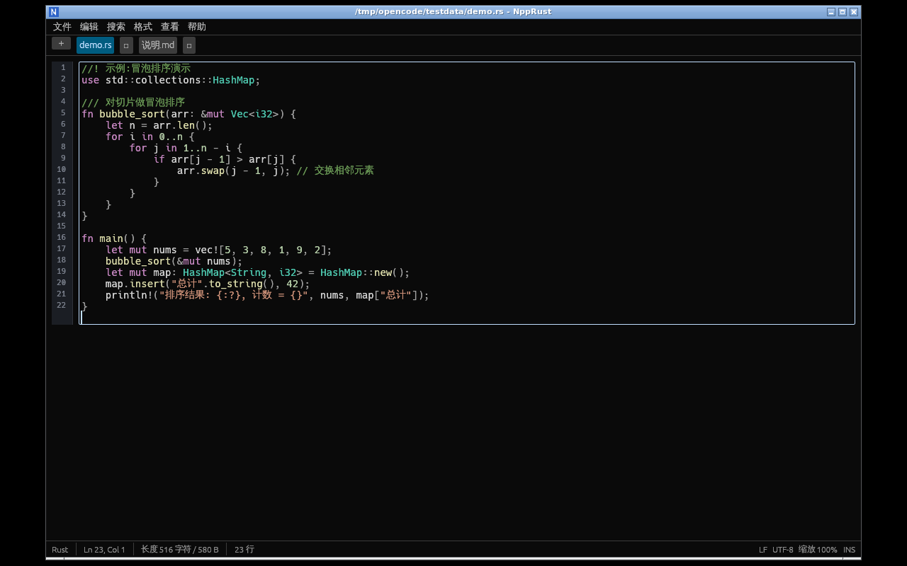
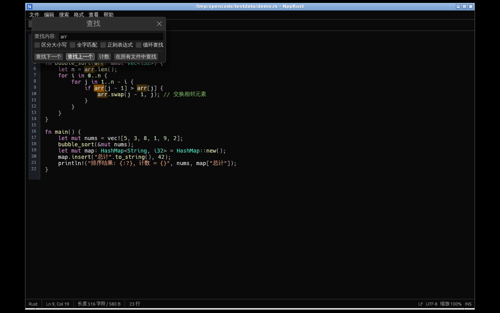
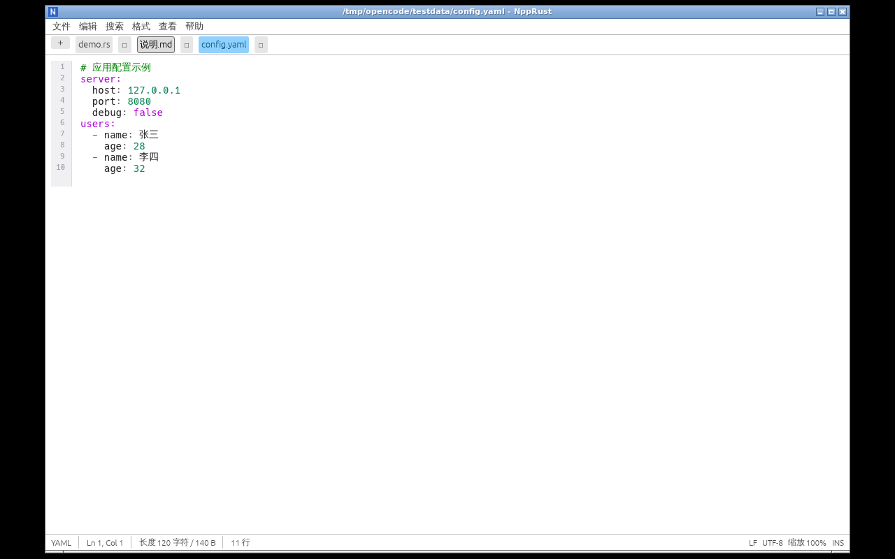

# NppRust —— 类 Notepad++ 的 Rust 记事本/代码编辑器



用 **Rust + egui/eframe** 编写的多标签文本/代码编辑器,界面与操作习惯尽量贴近 Notepad++(中文界面)。

单二进制、跨平台(Windows / macOS / Linux),无需安装,`cargo run` 即用。

## 功能一览

### 文件
- 多标签编辑:`Ctrl+Tab` / `Ctrl+Shift+Tab` 切换,标签右键菜单(保存 / 关闭 / 关闭其他 / 复制路径),中键关闭
- 新建 / 打开(多选)/ 保存 / 另存为 / 全部保存,最近打开文件(15 条)
- 拖放文件到窗口即可打开
- 退出前检测未保存文件并确认;关闭标签时逐个询问
- 打开所在文件夹(Windows 资源管理器 / macOS 访达 / Linux xdg-open)

### 编辑
- **自动缩进**(回车继承当前行缩进)、`Tab` / `Shift+Tab` 缩进与反缩进
- 行操作:复制当前行 `Ctrl+D`、删除当前行 `Ctrl+L`、上移/下移一行 `Alt+↑/↓`、
  升序/降序排序、反转行序、删除重复行、删除空行、去除行首/行尾空白、合并为一行
- 大小写转换:全部大写 / 全部小写 / 大小写互换 / 首字母大写
- `F5` 插入当前日期时间
- 撤销 / 重做(编辑器内建,`Ctrl+Z` / `Ctrl+Y`)

### 搜索
- 查找 / 替换对话框(`Ctrl+F` / `Ctrl+H`):区分大小写、全字匹配、**正则表达式**、循环查找
- `F3` / `Shift+F3` 查找下一个/上一个;计数;**在所有打开的文件中查找**(`Ctrl+Shift+F`)
- 匹配处橙色底色高亮,当前定位匹配更醒目
- 「查找结果」停靠面板,点击结果直接跳转到对应文件行
- 转到行 `Ctrl+G`

### 格式 / 编码
- 语法着色(17 种语言,按扩展名自动识别,可手动切换):
  Rust / Python / JavaScript / TypeScript / C / C++ / Java / C# / Go / JSON /
  XML·HTML / Markdown / Shell / SQL / YAML / TOML·INI / 纯文本
- 行号栏(与自动换行精确对齐)
- 自动换行开关 `Alt+Z`
- 编码:UTF-8 / UTF-8 BOM / UTF-16 LE·BE / **ANSI(GBK/GB18030)** / Big5 / CP1252
  读取时自动识别(无 BOM 且非 UTF-8 时按 ANSI 处理),可「转换为…」或「以编码重新加载」
- 换行符:Windows(CR LF)/ Unix(LF)/ Mac(CR),自动检测,保存时按设置转换

### 界面
- 暗色 / 亮色主题
- 字体缩放:`Ctrl+滚轮`、`Ctrl+=` / `Ctrl+-`、`Ctrl+0` 还原
- 状态栏:语言、行/列、选区、长度、行数、换行符、编码、缩放、INS/只读
- 全屏 `F11`
- 自动加载系统中文字体(微软雅黑 / Noto Sans CJK / 文泉驿等),中英混排正常显示

### 其他
- 只读模式(单文件开关)
- 外部修改监视:窗口重新聚焦时检测文件改动,未编辑文件自动重新加载,已编辑文件给出提示
- 设置与会话持久化(JSON,含主题/字体/换行/最近文件/上次打开的文件列表,可选启动恢复会话)
- 命令行直接打开文件:`npp-rust 文件1 文件2 …`

## 构建 / 运行

```bash
cargo run --release            # 运行(首次编译约几分钟)
cargo build --release
./target/release/npp-rust      # 直接启动
```

依赖:`cargo`(`rustup` 安装即可)。Linux 下需要常规 X11/Wayland 运行库(发行版一般自带);
Windows/macOS 无额外依赖。

## 快捷键

| 快捷键 | 功能 |
| --- | --- |
| `Ctrl+N` / `Ctrl+O` / `Ctrl+S` | 新建 / 打开 / 保存 |
| `Ctrl+Alt+S` / `Ctrl+Shift+S` | 另存为 / 全部保存 |
| `Ctrl+W` / `Ctrl+Shift+W` | 关闭标签 / 关闭全部 |
| `Ctrl+Tab` / `Ctrl+Shift+Tab` | 下一个 / 上一个标签 |
| `Ctrl+F` / `Ctrl+H` | 查找 / 替换 |
| `F3` / `Shift+F3` | 查找下一个 / 上一个 |
| `Ctrl+Shift+F` | 在所有打开的文件中查找 |
| `Ctrl+G` | 转到行 |
| `Ctrl+D` / `Ctrl+L` | 复制当前行 / 删除当前行 |
| `Alt+↑` / `Alt+↓` | 上移 / 下移一行 |
| `F5` | 插入日期时间 |
| `Ctrl+滚轮` / `Ctrl+0` | 缩放 / 还原缩放 |
| `Alt+Z` | 自动换行开关 |
| `F11` | 全屏 |

## 截图

查找与替换(带匹配高亮):



亮色主题:



## 与 Notepad++ 的差距(已知限制)

- 无宏录制、无插件系统、无列块编辑、无多视图分屏、无书签栏
- 语法高亮为轻量自研实现(关键字/字符串/注释/数字/函数/类型着色),精细程度不及 Scintilla
- 没有自动补全与函数列表
- 编辑器基于 egui,超大文件(数十 MB)流畅度不及 Scintilla 内核

## 代码结构

```
src/
├── main.rs      应用主体:菜单/标签栏/状态栏/对话框/快捷键/设置
├── editor.rs    编辑器组件:行号栏 + 高亮 layouter + 自动缩进 + 跳转
├── highlight.rs 语法着色引擎(17 种语言)
├── search.rs    查找/替换引擎(正则、全字匹配、循环)
├── textops.rs   行操作、大小写转换、字符/字节索引
├── files.rs     编码识别与转换、换行符处理、文件读写
├── tab.rs       标签页数据模型
└── settings.rs  设置持久化(JSON)
```

## 许可

MIT
